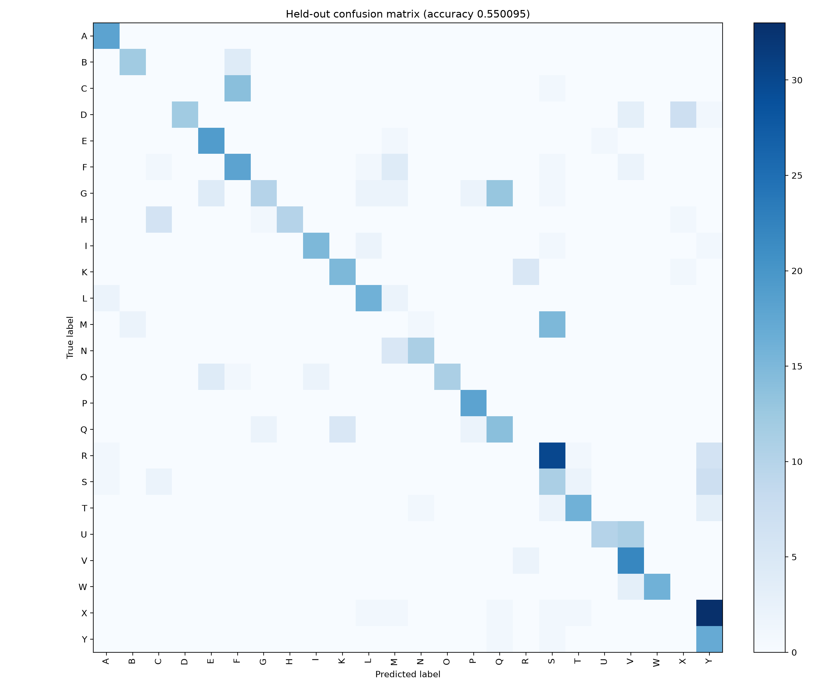

# SIGNAL real-data training report

## Data provenance

- Source: `collected` browser-collected landmark data.
- CSV files: signal_landmarks_participant_01_session_20261102194536.csv.
- Participants (1): participant_01.
- Sessions (1): session_20261102194536.
- Conditions: normal_lighting_front_view.
- Usable rows: 2594; removed for hand scale below 0.06: 3.
- Handedness counts after filtering: Left 1230, Right 1364.
- Counts per letter: A: 89, B: 77, C: 73, D: 112, E: 101, F: 131, G: 167, H: 90, I: 93, K: 103, L: 98, M: 89, N: 80, O: 87, P: 88, Q: 113, R: 188, S: 114, T: 107, U: 105, V: 116, W: 93, X: 188, Y: 92.
- `NONE` samples: 0.

## Split and evaluation

- Split: same-person, same-session, NOT generalization.
- Folds:
- single-recording: same-person, same-session, NOT generalization; accuracy 0.550095; macro-F1 0.574339; best epoch 48.
- Held-out accuracy: 0.550095.
- Held-out macro-F1: 0.574339.
- Held-out samples: 529.

## Per-letter precision and recall

| Letter | Support | Precision | Recall |
|---|---:|---:|---:|
| A | 18 | 0.818182 | 1.000000 |
| B | 16 | 0.857143 | 0.750000 |
| C | 15 | 0.000000 | 0.000000 |
| D | 23 | 1.000000 | 0.521739 |
| E | 21 | 0.703704 | 0.904762 |
| F | 27 | 0.486486 | 0.666667 |
| G | 34 | 0.769231 | 0.294118 |
| H | 18 | 1.000000 | 0.555556 |
| I | 19 | 0.882353 | 0.789474 |
| K | 21 | 0.750000 | 0.714286 |
| L | 20 | 0.727273 | 0.800000 |
| M | 18 | 0.000000 | 0.000000 |
| N | 16 | 0.846154 | 0.687500 |
| O | 18 | 1.000000 | 0.611111 |
| P | 18 | 0.818182 | 1.000000 |
| Q | 23 | 0.482759 | 0.608696 |
| R | 38 | 0.000000 | 0.000000 |
| S | 23 | 0.171875 | 0.478261 |
| T | 22 | 0.800000 | 0.727273 |
| U | 21 | 0.909091 | 0.476190 |
| V | 24 | 0.536585 | 0.916667 |
| W | 19 | 1.000000 | 0.842105 |
| X | 38 | 0.000000 | 0.000000 |
| Y | 19 | 0.250000 | 0.894737 |

## Confusion matrix

Rows are true labels; columns are predicted labels. Counts are held-out samples.

| True \ Predicted | A | B | C | D | E | F | G | H | I | K | L | M | N | O | P | Q | R | S | T | U | V | W | X | Y |
|---|---|---|---|---|---|---|---|---|---|---|---|---|---|---|---|---|---|---|---|---|---|---|---|---|
| A | 18 | 0 | 0 | 0 | 0 | 0 | 0 | 0 | 0 | 0 | 0 | 0 | 0 | 0 | 0 | 0 | 0 | 0 | 0 | 0 | 0 | 0 | 0 | 0 |
| B | 0 | 12 | 0 | 0 | 0 | 4 | 0 | 0 | 0 | 0 | 0 | 0 | 0 | 0 | 0 | 0 | 0 | 0 | 0 | 0 | 0 | 0 | 0 | 0 |
| C | 0 | 0 | 0 | 0 | 0 | 14 | 0 | 0 | 0 | 0 | 0 | 0 | 0 | 0 | 0 | 0 | 0 | 1 | 0 | 0 | 0 | 0 | 0 | 0 |
| D | 0 | 0 | 0 | 12 | 0 | 0 | 0 | 0 | 0 | 0 | 0 | 0 | 0 | 0 | 0 | 0 | 0 | 0 | 0 | 0 | 3 | 0 | 7 | 1 |
| E | 0 | 0 | 0 | 0 | 19 | 0 | 0 | 0 | 0 | 0 | 0 | 1 | 0 | 0 | 0 | 0 | 0 | 0 | 0 | 1 | 0 | 0 | 0 | 0 |
| F | 0 | 0 | 1 | 0 | 0 | 18 | 0 | 0 | 0 | 0 | 1 | 4 | 0 | 0 | 0 | 0 | 0 | 1 | 0 | 0 | 2 | 0 | 0 | 0 |
| G | 0 | 0 | 0 | 0 | 4 | 0 | 10 | 0 | 0 | 0 | 2 | 2 | 0 | 0 | 2 | 13 | 0 | 1 | 0 | 0 | 0 | 0 | 0 | 0 |
| H | 0 | 0 | 6 | 0 | 0 | 0 | 1 | 10 | 0 | 0 | 0 | 0 | 0 | 0 | 0 | 0 | 0 | 0 | 0 | 0 | 0 | 0 | 1 | 0 |
| I | 0 | 0 | 0 | 0 | 0 | 0 | 0 | 0 | 15 | 0 | 2 | 0 | 0 | 0 | 0 | 0 | 0 | 1 | 0 | 0 | 0 | 0 | 0 | 1 |
| K | 0 | 0 | 0 | 0 | 0 | 0 | 0 | 0 | 0 | 15 | 0 | 0 | 0 | 0 | 0 | 0 | 5 | 0 | 0 | 0 | 0 | 0 | 1 | 0 |
| L | 2 | 0 | 0 | 0 | 0 | 0 | 0 | 0 | 0 | 0 | 16 | 2 | 0 | 0 | 0 | 0 | 0 | 0 | 0 | 0 | 0 | 0 | 0 | 0 |
| M | 0 | 2 | 0 | 0 | 0 | 0 | 0 | 0 | 0 | 0 | 0 | 0 | 1 | 0 | 0 | 0 | 0 | 15 | 0 | 0 | 0 | 0 | 0 | 0 |
| N | 0 | 0 | 0 | 0 | 0 | 0 | 0 | 0 | 0 | 0 | 0 | 5 | 11 | 0 | 0 | 0 | 0 | 0 | 0 | 0 | 0 | 0 | 0 | 0 |
| O | 0 | 0 | 0 | 0 | 4 | 1 | 0 | 0 | 2 | 0 | 0 | 0 | 0 | 11 | 0 | 0 | 0 | 0 | 0 | 0 | 0 | 0 | 0 | 0 |
| P | 0 | 0 | 0 | 0 | 0 | 0 | 0 | 0 | 0 | 0 | 0 | 0 | 0 | 0 | 18 | 0 | 0 | 0 | 0 | 0 | 0 | 0 | 0 | 0 |
| Q | 0 | 0 | 0 | 0 | 0 | 0 | 2 | 0 | 0 | 5 | 0 | 0 | 0 | 0 | 2 | 14 | 0 | 0 | 0 | 0 | 0 | 0 | 0 | 0 |
| R | 1 | 0 | 0 | 0 | 0 | 0 | 0 | 0 | 0 | 0 | 0 | 0 | 0 | 0 | 0 | 0 | 0 | 30 | 1 | 0 | 0 | 0 | 0 | 6 |
| S | 1 | 0 | 2 | 0 | 0 | 0 | 0 | 0 | 0 | 0 | 0 | 0 | 0 | 0 | 0 | 0 | 0 | 11 | 2 | 0 | 0 | 0 | 0 | 7 |
| T | 0 | 0 | 0 | 0 | 0 | 0 | 0 | 0 | 0 | 0 | 0 | 0 | 1 | 0 | 0 | 0 | 0 | 2 | 16 | 0 | 0 | 0 | 0 | 3 |
| U | 0 | 0 | 0 | 0 | 0 | 0 | 0 | 0 | 0 | 0 | 0 | 0 | 0 | 0 | 0 | 0 | 0 | 0 | 0 | 10 | 11 | 0 | 0 | 0 |
| V | 0 | 0 | 0 | 0 | 0 | 0 | 0 | 0 | 0 | 0 | 0 | 0 | 0 | 0 | 0 | 0 | 2 | 0 | 0 | 0 | 22 | 0 | 0 | 0 |
| W | 0 | 0 | 0 | 0 | 0 | 0 | 0 | 0 | 0 | 0 | 0 | 0 | 0 | 0 | 0 | 0 | 0 | 0 | 0 | 0 | 3 | 16 | 0 | 0 |
| X | 0 | 0 | 0 | 0 | 0 | 0 | 0 | 0 | 0 | 0 | 1 | 1 | 0 | 0 | 0 | 1 | 0 | 1 | 1 | 0 | 0 | 0 | 0 | 33 |
| Y | 0 | 0 | 0 | 0 | 0 | 0 | 0 | 0 | 0 | 0 | 0 | 0 | 0 | 0 | 0 | 1 | 0 | 1 | 0 | 0 | 0 | 0 | 0 | 17 |

## Ten most confused letter pairs

Pairs rank by the sum of both confusion directions.

1. X / Y: 33 total (X→Y 33, Y→X 0)
2. R / S: 30 total (R→S 30, S→R 0)
3. C / F: 15 total (C→F 14, F→C 1)
4. G / Q: 15 total (G→Q 13, Q→G 2)
5. M / S: 15 total (M→S 15, S→M 0)
6. U / V: 11 total (U→V 11, V→U 0)
7. S / Y: 8 total (S→Y 7, Y→S 1)
8. D / X: 7 total (D→X 7, X→D 0)
9. C / H: 6 total (C→H 0, H→C 6)
10. M / N: 6 total (M→N 1, N→M 5)

## Calibration and rejection

- Temperature fitted on the validation block: 1.39764571.
- Validation ECE before temperature scaling: 0.06406978.
- Validation ECE after temperature scaling: 0.17090106.
- Reject if calibrated maximum probability is below 0.55346283, or the top-two margin is below 0.00172443, or the predicted class is `NONE`.
- Validation rejection selection: Validation grid search maximizing balanced accuracy for accepting correct known signs and rejecting incorrect or NONE predictions; ties prefer correct-sign coverage, then overall coverage.
- Validation balanced acceptance accuracy: 0.720013.
- Validation correct-sign coverage: 0.716216.
- Validation overall coverage: 0.600998.

## Known limitations

- This is a same-person, same-session, NOT generalization evaluation: only 1 participant and 1 session are represented.
- The data contains only these collection conditions: normal_lighting_front_view; it does not establish performance across lighting, camera angles, distances, or participants.
- No `NONE` transition examples were collected, so unknown-sign rejection is not validated against real transitions.
- Held-out accuracy is 0.550095; classes with zero held-out recall include C, M, R, X.
- Temperature was fit by minimizing validation cross-entropy, but measured validation ECE changed from 0.06406978 to 0.17090106; the ECE did not improve in this run.
- J and Z are excluded because they require motion trajectories; this is a static-pose classifier.
- Adjacent collected frames are temporally correlated, so the held-out score does not demonstrate independent-session or real-world generalization.
